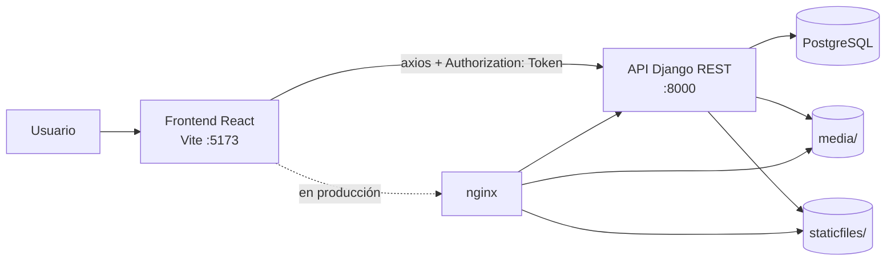
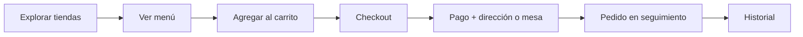
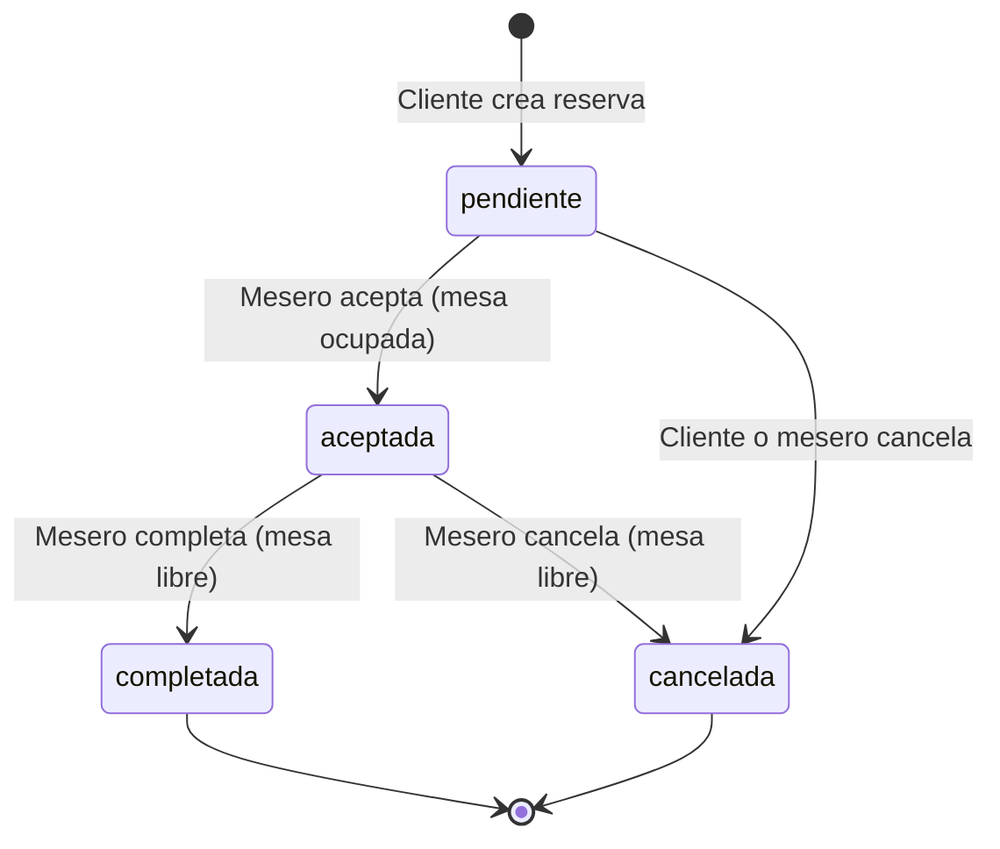

<div align="center">

# SIGR — Sistema de Gestión para Restaurantes


**Punto y Sazón** · Proyecto académico de gestión de software · Interfaz en español

</div>

---

## Índice

<details open>
<summary>Haz clic para desplegar el índice</summary>

- [¿Qué es SIGR?](#qué-es-sigr)
- [Vista rápida](#vista-rápida)
- [Tecnologías y herramientas](#tecnologías-y-herramientas)
- [Arquitectura general](#arquitectura-general)
- [Estructura del repositorio](#estructura-del-repositorio)
- [Puesta en marcha en local](#puesta-en-marcha-en-local)
- [Cómo se usa la app](#cómo-se-usa-la-app)
- [Módulos del backend](#módulos-del-backend)
- [API REST](#api-rest)
- [Comandos de referencia](#comandos-de-referencia)
- [Pruebas y calidad](#pruebas-y-calidad)
- [Datos de demostración](#datos-de-demostración)
- [Despliegue sin dominio (solo IP)](#despliegue-sin-dominio-solo-ip)
- [Solución de problemas](#solución-de-problemas)
- [Estado y deuda técnica](#estado-y-deuda-técnica)
- [Documentación adicional](#documentación-adicional)

</details>

---

## ¿Qué es SIGR?

**SIGR** es una aplicación web para la operación diaria de un restaurante pequeño. Reúne en un solo lugar la configuración del local, el menú, los pedidos con seguimiento de estados, las ventas y el caja, el equipo de trabajo, los turnos, las mesas y las reservas. Además, ofrece una experiencia pública para el comensal: explorar el catálogo, armar un pedido y hacer seguimiento del mismo.

Está enfocado en **dos audiencias**:

| Audiencia | Qué hace en SIGR |
|---|---|
| **Personal del restaurante** (administrador y meseros) | Configura el local, administra recetas y categorías, atiende pedidos, controla stock, programa turnos y gestiona reservas. |
| **Comensal** (cliente) | Consulta tiendas y platillos, arma su carrito, paga, revisa su historial y reserva mesa. |

Es un **proyecto académico / de curso**, en español, bajo la marca **Punto y Sazón**. No es un producto en operación.

> [!NOTE]
> La fuente de verdad sobre el producto (audiencias, propósito, decisiones abiertas) es `PRODUCT.md`. Este README documenta el **estado actual del código**, que ha avanzado más que ese documento.

---

## Vista rápida

¿Quieres verlo funcionando en 5 minutos? Necesitas PostgreSQL corriendo y node/pnpm instalados.

```bash
# 1. Backend
cd Back
python3 -m venv .venv
source .venv/bin/activate
pip install -r requirements.txt
cp .env.example .env          # rellena DB_* y genera SECRET_KEY (ver más abajo)
./run.sh migrate
./run.sh seed_catalog         # opcional: catálogo de ejemplo
./run.sh runserver            # http://127.0.0.1:8000

# 2. Frontend (en otra terminal)
cd Front
pnpm install
pnpm dev                      # http://127.0.0.1:5173
```

Comprobación rápida:

```bash
curl http://127.0.0.1:8000/health/
# {"status": "ok"}
```

---

## Tecnologías y herramientas

### Requisitos previos

| Herramienta | Versión recomendada | Para qué |
|---|---|---|
| **Python** | 3.12 o superior (Django 6.1) | Backend |
| **PostgreSQL** | 14+ | Base de datos |
| **pip / venv** | incluido con Python | Entorno virtual del backend |
| **Node.js** | 22+ | Frontend (Vite 8) |
| **pnpm** | 10+ | Gestor de dependencias del frontend |
| **Git** | cualquiera reciente | Control de versiones |

### Stack

| Capa | Tecnología |
|---|---|
| Backend | Django 6.1, Django REST Framework 3.18, `django-environ`, `django-cors-headers` |
| Base de datos | PostgreSQL (SQLite en memoria solo para tests) |
| Autenticación | DRF `TokenAuthentication` + `SessionAuthentication` |
| Frontend | React 19, Vite 8, React Router 8, HeroUI 3, Tailwind CSS 4 |
| Estado del cliente | Zustand 5 |
| Formularios y validación | react-hook-form + zod |
| Gráficas y animación | ECharts, motion |
| Peticiones HTTP | axios (con interceptor de token) |
| Servidor de producción | Gunicorn + nginx (estático y media) |

---

## Arquitectura general



- El frontend es una **SPA**: una sola página con rutas protegidas por rol.
- El backend expone una **REST API** modular, con 9 apps de dominio.
- Cada usuario tiene un `Profile` con `rol` (`cliente`, `mesero`, `administrador`) y, si aplica, un `restaurante` asociado.
- El token de sesión se guarda en `localStorage` del navegador y se envía en cada petición como `Authorization: Token <clave>`.

---

## Estructura del repositorio

```text
SIGR/
├── Back/                       # API Django
│   ├── config/                 # settings, urls, wsgi/asgi
│   │   ├── settings.py
│   │   ├── settings_testsqlite.py
│   │   └── urls.py
│   ├── restaurants/            # tiendas, platillos, notificaciones, seed_catalog
│   ├── categories/             # categorías del menú
│   ├── users/                  # usuarios, perfiles, direcciones, permisos
│   ├── orders/                 # pedidos, checkout, estadísticas, seed_demo_orders
│   ├── carts/                  # carrito de compras
│   ├── payment_methods/        # métodos de pago (sin guardar número completo)
│   ├── reservations/           # reservas de mesa
│   ├── shifts/                 # turnos del personal, seed_demo_shifts
│   ├── tables/                 # mesas
│   ├── common/                 # utilidades compartidas
│   ├── requirements.txt
│   ├── .env.example            # única plantilla de entorno del backend
│   ├── run.sh                  # atajo: manage.py con config.settings
│   └── run-tests.sh            # atajo: tests con SQLite en memoria
├── Front/                      # SPA React
│   ├── src/
│   │   ├── Api/                # clientes axios
│   │   ├── pages/              # home/, dashboard/admin/, dashboard/employ/, landingPage/
│   │   ├── components/         # globals/, landing/, staff/, shifts/, tables/, charts/
│   │   ├── store/              # sesión, carrito, notificaciones (Zustand)
│   │   ├── config/             # navegación por rol
│   │   └── hooks/              # useCatalog
│   ├── .env.example            # plantilla de VITE_API_URL
│   └── package.json
├── PRODUCT.md                  # documento de producto (impeccable)
├── graphify-out/               # grafo de conocimiento del código
└── README.md                   # este archivo
```

---

## Puesta en marcha en local

### 1. Base de datos

Crea una base de datos y un usuario en PostgreSQL. Por ejemplo, desde `psql` como superusuario:

```sql
CREATE USER sigr_user WITH PASSWORD 'cambia-esta-contraseña';
CREATE DATABASE sigr_db OWNER sigr_user;
```

Esos mismos valores irán en `DB_NAME`, `DB_USER`, `DB_PASSWORD`, `DB_HOST` y `DB_PORT`.

### 2. Backend

```bash
cd Back
python3 -m venv .venv
source .venv/bin/activate          # en Windows: .venv\Scripts\activate
pip install -r requirements.txt
cp .env.example .env
```

Edita `Back/.env` con tus valores reales:

```env
DEBUG=True
SECRET_KEY=<pega aquí la clave generada abajo>
ALLOWED_HOSTS=localhost,127.0.0.1

DB_NAME=sigr_db
DB_USER=sigr_user
DB_PASSWORD=cambia-esta-contraseña
DB_HOST=127.0.0.1
DB_PORT=5432

CORS_ALLOWED_ORIGINS=http://localhost:5173,http://127.0.0.1:5173
CSRF_TRUSTED_ORIGINS=
```

Genera la `SECRET_KEY`:

```bash
.venv/bin/python -c "from django.core.management.utils import get_random_secret_key; print(get_random_secret_key())"
```

Aplica migraciones y arranca:

```bash
./run.sh migrate
./run.sh runserver              # o: ./run.sh runserver 0.0.0.0:8000
```

> [!IMPORTANT]
> Si vas a entrar desde otro equipo con la IP del servidor, **añade esa IP a `ALLOWED_HOSTS`**. Si no, Django responderá `400 Bad Request` (DisallowedHost).

### 3. Frontend

```bash
cd Front
pnpm install
pnpm dev
```

Abre <http://127.0.0.1:5173>. Si el puerto 5173 está ocupado, Vite usará 5174, 5175, etc. No hace falta crear `.env.production` para desarrollar: el código ya usa `http://127.0.0.1:8000` por defecto.

### 4. Primer acceso

1. En la landing, pulsa **Iniciar sesión**.
2. Regístrate como **cliente** o crea un usuario con rol de **administrador** desde `/users/create/` (acepta `rol=administrador` y `Nombre del local`).
3. El modal guarda el token y te redirige según tu rol:
   - Cliente → `/home`
   - Administrador → `/dashboard/resumen`
   - Mesero → `/dashboard/pedidos`

---

## Cómo se usa la app

### Roles y permisos

| Rol | Ruta inicial | Qué puede hacer |
|---|---|---|
| **Cliente** | `/home` | Ver tiendas y platillos, carrito, checkout, direcciones, métodos de pago, historial de pedidos y reservas propias. Crear reserva y cancelar la suya si está pendiente. |
| **Mesero** | `/dashboard/pedidos` | Ver pedidos de su tienda y cambiar estados, disponibilidad y stock, notificaciones, mesas de sala, turnos propios y gestionar reservas de su tienda (aceptar, completar, cancelar). |
| **Administrador** | `/dashboard/resumen` | Todo lo del equipo más: empleados, categorías, recetas, mesas, turnos, estadísticas y CRUD de restaurante. Puede crear reservas, pero **no** aceptarlas ni completarlas. |
| **Superusuario Django** | `/admin/` | Sitio administrativo. Para la API necesita un `Profile` con rol y restaurante. |

<details>
<summary>Ver detalles de autenticación</summary>

- `POST /users/login/` acepta `usuario`, `correo`, `username` o `email`, y `contrasena` o `password`.
- Devuelve `token`, `id`, `username`, `email`, `rol` y `restaurante`.
- El frontend guarda el token en `localStorage` y lo envía como `Authorization: Token <clave>`.
- No hay endpoint de logout ni de renovación de token; el logout solo limpia el `localStorage`.

</details>

### Flujo del cliente



1. **Catálogo:** `/home/tiendas` y `/home/tiendas/:id` muestran locales y platillos activos, con filtros por categoría y búsqueda.
2. **Carrito:** `/home/carrito`. Solo admite productos de una misma tienda y respeta el stock.
3. **Métodos de pago:** `/home/metodos-pago`. Tarjeta, Nequi, Daviplata, PSE o efectivo. El número completo de tarjeta **no se guarda**: solo marca y últimos 4 dígitos.
4. **Direcciones:** `/home/direcciones`. Una sola predeterminada por usuario.
5. **Checkout:** elige `domicilio`, `mesa` o `llevar`. El checkout valida dirección o mesa, descuenta stock y vacía el carrito.
6. **Pedidos:** `/home/pedidos` para los activos y `/home/historial` para entregados/cancelados.
7. **Reservas:** `/home/reservas`. Selecciona restaurante, mesa, fecha, hora y número de personas.

### Flujo del mesero

1. **Pedidos** (`/dashboard/pedidos`): lista de pedidos de su tienda, filtros por tipo y alcance, cambio de estado en la parte superior.
2. **Reservas** (`/dashboard/reservas`): aceptar, completar o cancelar. La mesa se ocupa al aceptar y se libera al completar o cancelar una reserva aceptada.
3. **Disponibilidad** (`/dashboard/disponibilidad`): stock y activación de platillos.
4. **Turnos** (`/dashboard/turnos`): solo lectura de sus turnos.
5. **Notificaciones** (`/dashboard/notificaciones`): avisos de stock y pedidos, con toasts cada 30 s.



### Flujo del administrador

| Sección | Ruta | Acciones |
|---|---|---|
| Resumen | `/dashboard/resumen` | Ventas, pedidos, top platillos, categorías, métodos de pago, por hora, stock bajo. Parámetro `?dias=` entre 7 y 365. |
| Empleados | `/dashboard/empleados` | Alta, edición, desactivación y baja de meseros/admins de su tienda. |
| Categorías | `/dashboard/categorias` | Crear, renombrar y eliminar. |
| Recetas | `/dashboard/recetas` | Crear y editar platillos, imagen (máx. 5 MB), precio, disponibilidad. |
| Mesas | `/dashboard/mesas` | Crear, editar y eliminar mesas de su local. |
| Turnos | `/dashboard/turnos` | Programar turnos semanales (mañana/tarde/noche), detecta traslapes. |
| Pedidos | `/dashboard/pedidos` | Seguimiento y cambios de estado. |
| Disponibilidad | `/dashboard/disponibilidad` | Stock y activación. |
| Notificaciones | `/dashboard/notificaciones` | Avisos internos de la tienda. |

### Estados de un pedido

| Estado | Transiciones permitidas |
|---|---|
| `pendiente` | `confirmado`, `preparando`, `cancelado` |
| `confirmado` | `preparando`, `cancelado` |
| `preparando` | `en_camino`, `entregado`, `cancelado` |
| `en_camino` | `entregado`, `cancelado` |
| `entregado` | terminal |
| `cancelado` | terminal (devuelve stock) |

---

## Módulos del backend

| App | Responsabilidad | Modelos principales |
|---|---|---|
| `restaurants` | Locales, catálogo de platillos y notificaciones | `Restaurant`, `Dish`, `Notification` |
| `categories` | Categorías del menú | `Category` |
| `users` | Usuarios, perfiles/roles y direcciones | `User`, `Profile`, `Address` |
| `orders` | Pedidos, checkout y estadísticas | `Order`, `OrderItem` |
| `carts` | Carrito por usuario y por tienda | `Cart`, `CartItem` |
| `payment_methods` | Métodos de pago propios | `PaymentMethod` |
| `reservations` | Reservas de mesa y ciclo de vida | `TableReservation` |
| `shifts` | Turnos del personal | `Shift` |
| `tables` | Mesas del local y disponibilidad | `Table` |

> [!TIP]
> El prefijo de cada app coincide con su nombre: `/restaurants/`, `/categories/`, `/users/`, `/orders/`, `/carts/`, `/payment-methods/`, `/reservations/`, `/shifts/`, `/tables/`.

---

## API REST

Todas las respuestas son JSON. Los endpoints protegidos requieren:

```http
Authorization: Token <tu_token>
Content-Type: application/json
```

### Endpoints principales

<details>
<summary>Catálogo y tiendas</summary>

| Método | Ruta | Acceso | Descripción |
|---|---|---|---|
| GET | `/restaurants/` | público | Tiendas activas (`?search=`, `?categoria=`) |
| GET | `/restaurants/dishes/` | público | Platillos activos |
| GET | `/restaurants/<id>/menu/` | público | Menú de una tienda |
| GET | `/categories/` | público | Categorías activas |
| GET | `/tables/public/?restaurante=<id>` | público | Mesas disponibles |

</details>

<details>
<summary>Usuarios y sesión</summary>

| Método | Ruta | Acceso | Descripción |
|---|---|---|---|
| POST | `/users/create/` | público | Registro (acepta `rol`, alias `admin`/`empleado`) |
| POST | `/users/login/` | público | Login, devuelve `token` y `rol` |
| GET/POST | `/users/addresses/` | autenticado | Direcciones propias |
| GET/POST | `/users/employees/` | admin | Empleados de su tienda |

</details>

<details>
<summary>Compra</summary>

| Método | Ruta | Acceso | Descripción |
|---|---|---|---|
| GET/DELETE | `/carts/` | autenticado | Ver / vaciar carrito |
| POST | `/carts/items/` | autenticado | Agregar platillo |
| PATCH/DELETE | `/carts/items/<id>/` | autenticado | Cambiar cantidad / quitar |
| GET/POST | `/orders/` | autenticado | Listar / hacer checkout |
| GET | `/orders/staff/` | staff | Pedidos de la tienda |
| PATCH | `/orders/<id>/status/` | staff | Cambiar estado |
| GET | `/orders/stats/` | admin | Panel de estadísticas |
| GET/POST/DELETE | `/payment-methods/` | autenticado | Métodos de pago |

</details>

<details>
<summary>Operación del local</summary>

| Método | Ruta | Acceso | Descripción |
|---|---|---|---|
| GET/POST | `/reservations/` | autenticado | Listar / crear reserva |
| POST | `/reservations/<id>/accept/` | mesero | Aceptar (ocupa mesa) |
| POST | `/reservations/<id>/complete/` | mesero | Completar (libera mesa) |
| DELETE | `/reservations/<id>/cancel/` | autenticado | Cancelar |
| GET/POST | `/tables/` | admin | Mesas del local |
| GET | `/tables/staff/` | mesero | Mesas de sala |
| GET/POST | `/shifts/` | staff / admin | Ver / programar turnos |
| GET/PATCH | `/restaurants/availability/` | staff | Stock y disponibilidad |
| GET | `/restaurants/notifications/` | staff | Avisos de la tienda |

</details>

### Health check

```bash
curl http://127.0.0.1:8000/health/
# {"status": "ok"}
```

---

## Comandos de referencia

### Backend (desde `Back/`)

| Comando | Qué hace |
|---|---|
| `./run.sh runserver` | Servidor de desarrollo en `127.0.0.1:8000` |
| `./run.sh runserver 0.0.0.0:8000` | Servidor accesible desde la red |
| `./run.sh check` | Comprobaciones de Django |
| `./run.sh makemigrations` | Genera migraciones |
| `./run.sh migrate` | Aplica migraciones |
| `./run.sh collectstatic --noinput` | Genera `staticfiles/` para producción |
| `./run.sh seed_catalog` | Carga categorías, tiendas y platillos de ejemplo |
| `./run.sh seed_demo_orders` | Genera pedidos de demostración |
| `./run.sh seed_demo_shifts` | Genera turnos de demostración |
| `./run-tests.sh test --verbosity 2 --noinput` | Tests con SQLite en memoria |

### Frontend (desde `Front/`)

| Comando | Qué hace |
|---|---|
| `pnpm dev` | Servidor de desarrollo Vite |
| `pnpm build` | Compila el bundle en `dist/` |
| `pnpm preview` / `pnpm start` | Sirve `dist/` localmente |
| `pnpm lint` | ESLint sobre todo el proyecto |
| `pnpm test` | Ejecuta los tests del backend (atajo a `run-tests.sh`) |
| `pnpm makemigrations` | Ejecuta `bash ../Back/run.sh makemigrations` |
| `pnpm migrate` | Ejecuta `bash ../Back/run.sh migrate` |

> [!NOTE]
> Los scripts `makemigrations`, `migrate` y `test` de `package.json` usan rutas relativas (`../Back/...`) para que funcionen aunque `pnpm` ejecute desde `Front/`.

---

## Pruebas y calidad

```bash
# Backend (desde Front/ también funciona)
pnpm test

# O directamente desde Back/
./run-tests.sh test --verbosity 2 --noinput

# Calidad del frontend
pnpm lint
pnpm build

# Comprobaciones de despliegue
./run.sh check
DEBUG=False SECRET_KEY='clave-larga-y-aleatoria' ALLOWED_HOSTS='tu-ip' \
  .venv/bin/python manage.py check --deploy
```

- Los tests corren con **`config.settings_testsqlite`**: SQLite en memoria, así que no tocan tu PostgreSQL real.
- Resultado actual: **39 tests, todos OK**.
- `pnpm build` puede avisar de chunks mayores a 500 kB (ECharts y el bundle principal); es una advertencia, no un error.

---

## Datos de demostración

Opcional, después de `migrate`:

```bash
./run.sh seed_catalog       # 6 categorías, 7 tiendas, 15 platillos
./run.sh seed_demo_orders   # pedidos de los últimos 90 días + casos de stock bajo
./run.sh seed_demo_shifts   # turnos de las últimas 4 semanas
```

Opciones útiles:

```bash
./run.sh seed_demo_orders --dias 30 --por-dia 3 --clientes 5
./run.sh seed_demo_orders --limpiar        # borra pedidos DEMO- y clientes demo
./run.sh seed_demo_shifts --semanas 2 --limpiar
```

---

## Despliegue sin dominio (solo IP)

No necesitas dominio para desplegar: usa la IP del servidor en los tres sitios donde aparece.

### 1. Backend

En el servidor:

```bash
cd Back
python3 -m venv .venv
source .venv/bin/activate
pip install -r requirements.txt     # incluye gunicorn
cp .env.example .env
```

`Back/.env` para un servidor con IP (sin HTTPS):

```env
DEBUG=False
SECRET_KEY=<clave-larga-y-aleatoria-generada-con-el-comando-anterior>
ALLOWED_HOSTS=localhost,127.0.0.1,192.168.1.50

DB_NAME=sigr_db
DB_USER=sigr_user
DB_PASSWORD=<contraseña-real>
DB_HOST=127.0.0.1
DB_PORT=5432

CORS_ALLOWED_ORIGINS=http://192.168.1.50:5173
CSRF_TRUSTED_ORIGINS=http://192.168.1.50:8000

TRUST_PROXY_SSL_HEADER=False
SECURE_SSL_REDIRECT=False
SESSION_COOKIE_SECURE=False
CSRF_COOKIE_SECURE=False
SECURE_HSTS_SECONDS=0
SECURE_HSTS_INCLUDE_SUBDOMAINS=False
SECURE_HSTS_PRELOAD=False

DEFAULT_FROM_EMAIL=no-reply@sigr.local
```

Sustituye `192.168.1.50` por la IP real. `ALLOWED_HOSTS` es obligatorio: sin la IP, cualquier petición externa dará **400**.

Aplica migraciones y prepara estáticos:

```bash
./run.sh migrate --noinput
./run.sh collectstatic --noinput
./run.sh check
```

Arranca con Gunicorn (no con `runserver`):

```bash
.venv/bin/gunicorn config.wsgi:application --bind 0.0.0.0:8000 --workers 3
```

### 2. Frontend

La variable `VITE_API_URL` se **incrusta en el bundle al compilar**. Cambiarla después no sirve: hay que recompilar.

```bash
cd Front
cp .env.example .env.production
# editar .env.production:
# VITE_API_URL=http://192.168.1.50:8000
pnpm install
pnpm build
```

El resultado queda en `Front/dist/`. Sírvelo con nginx (o cualquier servidor estático), redirigiendo todas las rutas a `index.html` porque es una SPA.

### 3. nginx (esquema mínimo)

```nginx
server {
    listen 80;
    server_name 192.168.1.50;

    location / {
        root /ruta/al/proyecto/Front/dist;
        try_files $uri $uri/ /index.html;
    }

    location /static/ {
        alias /ruta/al/proyecto/Back/staticfiles/;
    }

    location /media/ {
        alias /ruta/al/proyecto/Back/media/;
    }

    location /health/ {
        proxy_pass http://127.0.0.1:8000;
    }
}
```

> [!WARNING]
> Con `DEBUG=False`, Django **no sirve `/media/` ni `/static/`**. Sin esos dos bloques de nginx, las imágenes de tiendas y platillos no se verán.

Si el frontend se sirve desde otra IP o puerto, actualiza `CORS_ALLOWED_ORIGINS` con ese origen exacto (esquema + IP + puerto). Cuando tengas dominio y HTTPS, cambia los `SECURE_*` a `True` y usa `https://` en CORS/CSRF.

---

## Solución de problemas

| Síntoma | Causa probable | Solución |
|---|---|---|
| `400 Bad Request` al entrar por IP | La IP no está en `ALLOWED_HOSTS` | Añadirla: `ALLOWED_HOSTS=localhost,127.0.0.1,<tu-ip>` |
| El navegador bloquea las peticiones | Origen del front ausente en CORS | Añadir `http://<ip-del-front>:<puerto>` a `CORS_ALLOWED_ORIGINS` |
| `401 Unauthorized` | Token ausente o caducado | Iniciar sesión de nuevo; se guarda un token nuevo en `localStorage` |
| Build falla con `Could not resolve ../../assets/...` | Faltan los assets de la landing | Verificar que `Front/src/assets/{portada.png,menu.jpg,pedidos.png,ventas.png}` y `Front/src/components/landing/ManageCard.jsx` estén versionados |
| `pnpm makemigrations` dice `run.sh: orden no encontrada` | Script antiguo con ruta absoluta | Ya corregido: usa `bash ../Back/run.sh ...` |
| Las imágenes no cargan en producción | nginx no sirve `/media/` | Configurar `location /media/` (ver arriba) |
| `No changes detected` al hacer migraciones | Modelos ya sincronizados | Normal; verificar con `./run.sh makemigrations --check --dry-run` |

---

## Estado y deuda técnica

Conocida y documentada para no descubrirla en producción:

- El CRUD genérico de `/users/` y `/users/login/` quedan con el permiso global `AllowAny`. El CRUD de `/restaurants/` solo exige autenticación, sin verificación de rol.
- No hay endpoint de logout ni de renovación de token en la API.
- `PRODUCT.md` está desactualizado respecto al código (describe un backend mucho más pequeño).
- Existe `Back/requiriments.txt` (nombre con error) además de `Back/requirements.txt`; usa siempre este último.
- Hay un archivo suelto `Back/reservations/0002_alter_tablereservation_mesa.py` fuera de `migrations/` que parece una copia obsoleta.
- `graphify-out/` está generado desde un commit anterior; si lo usas como referencia, actualízalo con `graphify update .`.

---

## Documentación adicional

| Archivo | Para qué sirve |
|---|---|
| `PRODUCT.md` | Producto, audiencias, propósito y decisiones abiertas (impeccable) |
| `graphify-out/GRAPH_REPORT.md` | Mapa automático de arquitectura y comunidades del código |
| `Back/.env.example` | Única plantilla de variables del backend |
| `Front/.env.example` | Plantilla de `VITE_API_URL` |

---

<div align="center">

Hecho para el proyecto SIGR · Punto y Sazón · Español

</div>
